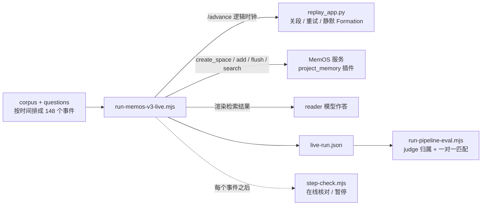

# Memmy 项目记忆评测：v3 数据集、flush 回放与 MemOS Add 的逐事件 badcase 分析

本分支 `feat/project-memory-gold-v3-flush` 是项目记忆的**评测分支**：存放 v3 数据集、按 flush 口径推出的 gold（revision 2）、对 MemOS 的在线回放与评分，以及 2026-11-26 对 MemOS Add 做的一次逐事件 badcase review。本 README 介绍数据集和评测，汇报这次 review 的结论与改进意见。Memmy 产品本身的介绍见 [README.zh-CN.md](README.zh-CN.md) 和主分支。

- 逐案例笔记（证据、调用、修改意见）：[docs/project-memory/v3-flush-stepwise-notes.md](docs/project-memory/v3-flush-stepwise-notes.md)
- 数据集与指标的细节说明：[eval/project-memory/gold-add-memory/README.md](eval/project-memory/gold-add-memory/README.md)
- 历史运行记录：[docs/project-memory/metrics.md](docs/project-memory/metrics.md)

## 1. 结论速览

被测版本：MemOS `promem_dev-rjf@3d8450ba`，SUT 模型是 `deepseek-v4.1-flash-1017`。按时间顺序逐事件回放，每次 Add 处理完、每道题答完都在线核对，出错就暂停查看现场。共跑了 148 个事件中的前 57 个，覆盖 ledger 和 catalog 两个 Space 的第一天：核对 33 次 Add、判 23 道题，答对 12 题（52%）；19 次暂停，从中归纳出 11 类根因。用户确认后续不再出现新的错误类别后，review 停止。

1. **Topic 粒度是最大的结构性问题（案例 3、4、10）。** Topic 的名称和交付对象按建它的第一条规则生成，比如「月报金额从journal正文提取」，没有上升到「ledger 月报」这一项工作。后来同一份报表的规则在 assign 阶段都对不上，进入 staged，再由 Formation 一条规则建一个 Topic。到 19:57，gold 有 5 个 Topic，MemOS 有 15 个。Formation 还会按**结论**给 cluster 命名，把同一事项的相反立场拆进两个 Topic，于是冲突永远进不了 merge。
2. **冲突链在 merge 环节断裂（案例 8、9）。** 「README 里写明金额还在 journal 正文」这类复述或文档任务，被当成负责人对原决策的改写。原结论进了 history，后来的反对意见失去锚点，被记成了独立的新决策。另一种情况是负责人改到和对方一致的立场后，对方的冲突项因为 `same_as` 判得太严而没有并掉，确定的规则被呈现成仍有争议。
3. **证据校验过严，整条丢弃（案例 1、2）。** Agent 在同一轮回复里给出的规范写法（东八区 → UTC+8）和示例值（2026-10.txt），因为模型没有在 `context` 里显式引用，content 里多出一个 token，整条 decision 就被丢掉。对应的问题（时区、报告路径）直接答不出来。
4. **抽取口径有几处和 gold 不一致（案例 5、6、7）。** 执行步骤被写成 decision，计划被写成 timeline；Agent 交代的交付约定，以及「X 会…」形式的已完成描述没有记下来；成员给记忆系统本身定的规则（「什么算冲突」）被写成了项目决策。
5. **11 道错题里有 10 道的根因在 Add。** reader 的问题只有一类：措辞不同时拒答（案例 11）。search 只返回 Topic 内命中的条目，又用了英文 MiniLM 嵌入，会放大 Add 的问题，但不是根因。

按收益排序的修改意见见第 6 节。前三项（Topic 按工作或产出物粒度建、Formation 只按对象命名并在建后补一道「同一事项」判定、merge 不把复述当改写）预计能同时改善 topic F1、duplicateTopics、conflictAsEntry 和 conflict 类答题。

**修改后的复测与空白对照（2026-11-26，详见 4.1 节）：** 按第 6 节改过的 MemOS（`promem_dev-rjf@31a38794`）完整跑了 3 次 v3。答题是 0.857（0.914 / 0.857 / 0.800），topic F1 0.667，entries.f1 0.806，recall@3 0.971，都明显高于 11-24 的 flush 运行，重复 Topic 也从 7–15 个降到 3–11 个。但不接任何记忆、只给原始会话文件的空白对照组，答题达到 0.924（3 次），比 MemOS 高。在 v3 这样每个 Space 只有几十轮会话的规模上，直接读原文又便宜又准。MemOS 的优势只能在 reader 每题输入 token 上体现（约 1.5k，对照组约 4.8k），而且需要更长的历史才能拉开。这次修改还引入了一个新问题：同一 Topic 里不同对象的兄弟规则（早班和夜班、冷链和冷冻）被 merge 当成同一事项，记成了冲突，q43、q44 三次全错。

## 2. 数据集 v3

数据集模拟一个团队的多位成员，在多个 Space 里通过各自的 Agent 会话推进工作。被测系统只能通过规格接口（create_space / add / scheduler status / flush / get_memory / search）看到对话，看不到任何标注。

| 项 | 数量 | 说明 |
|---|---|---|
| Space | 6 | ledger（代码开发 / 工程规范）、catalog（代码开发 / 产品设计）、clinic、warehouse、fleet、kitchen |
| 成员 | 7 | 林工、周工、陈工、赵工、吴工、孙工、郑工 |
| 会话 | 17 | 写入会话和只提问的会话 |
| Trace（一次 Add） | 113 | 每条有 `chat_time`、`reply_time`；12 条迟交（`submit_time`）、5 条重发（`resubmitOf`）、1 条先检索再写（`searchBefore`） |
| 语义 Episode | 78 | 其中 18 个多轮，见 `dataset/episodes.json` |
| gold Topic | 46 | 带有效期的摘要和描述要点 |
| gold 条目 | 95 | decision 64、experience 1、timeline 30；其中 12 条 optional，5 条是「成员改了自己结论」的变更记录 |
| 不该写入（negatives） | 25 | 执行步骤、复述、无关内容（如回复格式、「什么算冲突」） |
| 问题 | 37 | 1 道 excluded；flush 口径下再排除 q21、q49，实问 35 道：plain 14、space-isolation 10、conflict 5、stale 4、visibility 3 |
| 接口检查 | 4 | 不带 `space_ids` 的检索和写入必须被拒、跨 Space 隔离、未登记领域被拒 |

**标注规则要点**（完整规则见数据集 README）：

- decision 只记范围、对外约定和共同约定；局部实现、执行步骤、未采纳方案、未决事项、复述都不写。输出约定（报告路径、导出格式）算 decision。
- 冲突处理：只有作者本人能 `rewrite`；作者在某一项不一致结论里时是 `conflict_update`；都不是则 `conflict_append`；成员被告知各项后拍板是 `resolve`。转述别人的同意不算授权。
- 成员改了自己的结论时，同一轮要另记一条 timeline「谁把什么改成了什么」（`changeOf`）。

**gold revision 2（flush 口径，默认）**：回放在每道题检索前 flush 该题的 Space，最终读取前 flush 全部 Space。gold 据此按「提问前该 Space 的 Add 都已关段、整理并完成 Formation」推出。离线参考时钟和产品的默认计时器保持一致：空闲 15 分钟、8 轮、首轮等待 30 分钟关段；暂存累计 10 段或等待 2 小时触发 Formation。`processingBatches` 和 `visibilityEvents`（419 个）给出每条 Trace 在 gold 里的受理、关段、暂存和提交时刻，逐事件 review 就靠它们判断「此时 gold 应该是什么样」。

## 3. 评测方法



- **回放**（`eval/project-memory/gold-add-memory/run-memos-v3-live.mjs`）：
  - 按受理时间（`submit_time ?? reply_time`）和提问时间合并成一条时间线，逐个事件推进逻辑时钟。
  - 时钟 app（`runs/20261120-memos-v3/replay_app.py`）把 SQL 的 `now()` 钉在逻辑时间上，并且在每次推进时把到期的关段、阶段重试和静默 Space 的 Formation 都跑完。
  - Add 事件发 `/product/add`，问题事件先 flush 该 Space、再 `/product/search`（`memory_limit_number: 9`），然后把结果按模板交给 reader 作答。MemOS 本身不负责回答。
- **评分**（`run-pipeline-eval.mjs`）：
  - 只看最终状态。judge 把每条写入归属为 match / stale / conflict / negative / none，再与 gold 做一对一匹配。
  - 主要指标：`entries.{P,R,F1}`、`decisions.stateExact`（内容、冲突、历史、成员、时间全对）、`topics.bcubed.f1`、`search.recall@k`、`answers.llm`，并按冲突和非冲突分组报告。
  - gate 要求 stateExact、topic F1、entries.f1、answers.llm 都 ≥ 0.8，recall@3 ≥ 0.85，接口检查全过，并且旧版本被当成当前、跨空间泄漏、编造原因、错误合并都为 0。
- **模型**（`harness/model-env.mjs`）：按 deepseek → openai → claude 选择 SUT、reader 和 judge，judge 必须和 SUT 不同家族。本次加了 `--pin`：续跑时沿用 `models.json` 里记录的模型；某个模型不可用时按顺序回落，并把切换记进 `models.json.switches`。每题记录作答时用的 `readerModel`。
- **逐事件 review**（本次新增）：
  - `--pause-on-bad` 在每个事件之后调用 `harness/step-check.mjs`。一次 Add 要等 gold 已提交、并且 MemOS 承载它的 Episode 也都处理完（或刚被 flush）才核对：gold 的每个 op 是否存在、是否唯一、是否在对应的 Topic 里、冲突和历史的条数是否一致、flush 之后是否仍停在 staged。
  - 新写入的条目先按最终 gold 归属，再按当时的 gold 状态复核。
  - 答错的题会标出事实丢在哪一层（add / search / reader）。
  - 用 gold 自身回放时零暂停，用空记忆回放时在第一个提交点暂停；这两条是核对器自身的检验。
  - 暂停时用 `show-pause.mjs` 展示现场，用 `inspect-memos.py` 查看 add_jobs、Episode、Topic 以及每次模型调用的 prompt 和输出（经 usage proxy 记录），用 `triage-missing.py` 复现 draft 被丢弃的具体原因。

## 4. 历史结果

| 运行 | 口径 | entries.f1 | stateExact | topic F1 | recall@3 | answers |
|---|---|---|---|---|---|---|
| R-20261120-01 | 计时器口径（revision 1） | 0.764 | 0.738 | 0.573 | 0.970 | 0.722 |
| 11-24 a（merge 后） | flush | 0.76–0.78 | ~0.69 | ~0.61 | 0.63–0.71 | 0.54–0.57 |
| 11-24 c（兄弟规则分开记） | flush | 0.73 | 0.78–0.81 | 0.55 | 0.74–0.77 | 0.51–0.69 |
| 11-24 d（抽取 prompt D） | flush | 0.77–0.79 | 0.77–0.80 | ~0.62 | — | 0.54–0.57 |

11-24 的四组运行每次都有 7–15 个重复 Topic、4–7 条旧版本被当成当前、6–10 条冲突被单独写成条目；conflict 题的正确率只有 0.2–0.4，gate 全部没过。这些运行的目录随旧 worktree 一起删除了，数字来自删除前的记录。冲突组的条目 F1 约 0.4、stateExact 0.08–0.17，非冲突组约 0.9 / 0.82，说明问题集中在冲突链和 Topic 结构上，这正是这次逐事件 review 要查清的。

### 4.1 修改后的复测与空白对照（2026-11-26）

被测：MemOS `promem_dev-rjf@31a38794`，即第 6 节的 7 项修改，worktree `MemOS-eval-new`。SUT 和 reader 是 `deepseek-v4.1-flash-1017`，judge 是 `gpt-6-luna`。完整 flush 回放（148 个事件），共 3 次，每次各用一个独立的本地库。

| 运行 | entries.f1 | stateExact | topic F1 | recall@3 | answers | conflict / stale / plain / 隔离 | 重复 Topic / 错误合并 | 冲突单独成条 / 旧版当前 |
|---|---|---|---|---|---|---|---|---|
| MemOS run 1 | 0.809 | 0.797 | 0.672 | 0.943 | 0.914 | 1.00 / 0.80 / 0.88 / 1.00 | 3 / 2 | 7 / 2 |
| MemOS run 2 | 0.798 | 0.781 | 0.635 | 1.000 | 0.857 | 0.75 / 0.80 / 0.81 / 1.00 | 11 / 0 | 9 / 2 |
| MemOS run 3 | 0.811 | 0.797 | 0.694 | 0.971 | 0.800 | 0.75 / 0.60 / 0.75 / 1.00 | 6 / 0 | 7 / 3 |
| **MemOS 均值** | **0.806** | **0.792** | **0.667** | **0.971** | **0.857** | 0.83 / 0.73 / 0.81 / 1.00 | 6.7 / 0.7 | 7.7 / 2.3 |
| 空白对照 ×3（均值） | — | — | — | — | **0.924**（0.943 / 0.886 / 0.943） | 0.75 / 0.93 / 0.92 / 1.00 | — | — |

**空白对照组**（`eval/project-memory/gold-add-memory/history-baseline.mjs`，prompt 版本 2）：
- 不接任何记忆系统。reader 只知道有 6 个项目、每个项目的目录，以及会话记录在各自的 `sessions/` 下（一个会话一个文件）。
- 文件是提问时刻之前已经提交的原始轮次，按「时间 成员：请求 / 时间 Agent：回复」逐行排列，覆盖所有项目。
- 工具只有通用的 `list_dir`、`read_file`（带行号）和 `grep`（子串匹配），最多 12 步，最后一步必须作答。
- 回答规则和 MemOS 的 reader 相同，judge、gold 答案和陷阱文本也相同，所以 answers.llm 可以一一对照。
- 没有任何摘要、概要、去重或裁决，也不展示 MemOS 产出的任何内容。
- 第一版对照组（v1）设计偏多：带首轮请求的会话索引、截到 80 字的逐轮概要、只看本 Space、提示「以时间更晚的为当前状态」。按评审意见改成了现在的版本。v1 三次的答题为 0.886 / 0.857 / 0.914，只作参考。

**错题对照：**

| 题目 | 类型 | MemOS（3 次里错几次） | 空白对照 | 原因 |
|---|---|---|---|---|
| q07 | stale | 3 | 0 | MemOS 的 timeline 里还留着「写成 prices.json」，reader 判成两处不一致。这是第 6 节的「X 会…」口径改动带来的：旧格式的完成描述被记成了 timeline |
| q43、q44 | plain | 3、3 | 1、1 | **新回归**：冷链和冷冻、早班和夜班进了同一个 Topic（和 gold 一致），但 dec.update 把不同对象的兄弟规则当成同一事项，记成了冲突，reader 于是答「尚未定论」 |
| q09 | conflict | 2 | 3 | 两边都没稳定答出林工和周工两种结论 |
| q17 | plain | 2 | 0 | 空客户仍有分歧这一点，MemOS 没有稳定呈现 |
| q13、q15 | — | 1、1 | 1、2 | 偶发 |

**开销（每次 v3 运行，35 道题；按 pricing.json 逐次计价）：**

| 项 | MemOS（run 3） | 空白对照（v2 ×3） |
|---|---|---|
| 写入（Add） | 419 次调用；输入 481k + 缓存 83k，输出 46k；$0.0999；整理 462 s（发生在写入侧，提问时不需要等） | 无 |
| 检索 | 36 次 search，P50 27 ms，不调模型 | 无（读文件计入 reader） |
| 回答（reader） | 35 次调用；输入 54k（约 1.5k/题），输出 3.8k；$0.0103；共 52 s（约 1.5 s/题） | 120–125 次调用；输入 163–173k（其中缓存命中 96–119k，约 4.8k/题），输出 14–15k；$0.016–0.019；每题 4.9–5.2 s（P95 6.5–6.7 s） |
| 合计 | $0.110 | $0.016–0.019 |

**结论：**
1. 修改后的 MemOS 比 11-24 的 flush 运行（答题 0.54–0.57，topic F1 约 0.6）明显好，但 gate 仍然没过：stateExact 0.79、topic F1 0.67，重复 Topic 和冲突单独成条都还在。
2. 在 v3 的规模上（每个 Space 几十轮），空白对照组答题 0.924，高于 MemOS 的 0.857，总花费只有 MemOS 的约 1/6。MemOS 的长处在 reader 侧：每题输入 token 只有对照组的约 1/3，并且不随历史变长而增长。但这个数据集太小，体现不出这个长处。要说明项目记忆的价值，需要历史长到原文读不完的数据，比如更长的 v3 语料或 FrontierMemory。
3. 下一步要修的问题：merge 判断「同一件事」时没有锁定对象（早班和夜班、冷链和冷冻）；timeline 口径改动后，旧格式的完成描述没有被新的格式取代（q07）。
4. **FrontierMemory 190 Turn（同一份修改，跑 1 次后按约定停止）**：主口径 split-or-merge 55.4，落在基线 `4b879894` 三次的范围内（41.5 / 53.8 / 55.4，均值 50.3），没有提高；按「先跑一次，没有提高就停」的约定，没有再跑 3 次。结构上出现了反向的变化：merge 形状从 2–7 项变成 19 项，严格 1:1 从均值 41.5 降到 24.6，跨用户配对精确率从 20.9–38.1 降到 14.4，召回从约 63 升到 83.2；跨用户冲突保住 1/3（基线 0–1/3）；Add 花费 $1.98（基线约 $1.4，需要把预算上限调到 $3 才能跑完）。这说明「拿不准时按交付对象判断、同一对象合并」在 v3 上减少了一规则一 Topic 的拆分，在 FrontierMemory 上却让同一仓库的兄弟功能更容易并进上位 Topic。两个数据集的粒度要求需要一个更明确的「交付对象」判据，比如以能否单独验收为准，而不是只看是否同一产出物。

## 5. 本次逐事件 review

运行目录：`eval/project-memory/runs/20261126-stepwise/`（gitignored）。被测代码冻结在 detached worktree `MemOS-stepwise@3d8450ba`，使用独立的本地库 `add_verify_step` 和 schema `memos_v3_58100`。

| 项 | 结果 |
|---|---|
| 覆盖 | event 0–56（10-21 09:17–19:57）：ledger 和 catalog 两个 Space，33 次 Add，23 道题；全程无请求失败 |
| 答题 | 23 题答对 12 题。reader 在 event 43 因 deepseek TPM 限流切到 gpt-6-luna：deepseek 答 10 对 6，gpt-6-luna 答 13 对 6 |
| 暂停 | 19 次，其中 3 次是核对器误报（已修复并补测试） |
| 问题计数 | answer_wrong 11、missing 8、topic_split 8（gold 5 个 Topic 里有 4 个被拆开）、conflict_state 5、conflict_as_entry 5、negative_write 3、not_formed 2、history_state 1、unattributed 1 |
| Topic 数 | gold 5 个，MemOS 15 个（ledger 9 个，catalog 6 个），没有错误合并 |

**错题归因**：

| 题目 | 现象 | 根因 |
|---|---|---|
| q02、q25 | 把有争议的金额口径答成定论 | 案例 8 |
| q04、q17 | 冲突项还是旧措辞，或者回答没有提到仍有分歧 | 案例 3、8 |
| q09 | 只答出一方结论 | 案例 4 |
| q15 | 漏了「样例改动已撤回」 | 案例 3（信息分散在多个 Topic） |
| q13 | 已经一致的规则被答成「尚未确定」 | 案例 9 |
| q07 | 导出格式还答 json | 案例 10（csv 的改写停在 staged） |
| q26 | 时区答不出 | 案例 1 |
| q28 | 报告路径答不出 | 案例 2 |
| q06 | 「取整」问题拒答 | 案例 11（reader）和案例 1（content 缺 Agent 的规范写法） |

## 6. 根因与修改意见

按优先级排列。证据（Episode、模型调用、代码位置）见笔记里对应的案例。

### P0

**案例 3：Topic 按单条规则建（assign 和 Formation）。**
- 现象：assign 每次都是拿「Episode 的交付物」去比「Topic 的交付物」，而 Topic 的交付物就是它的第一条规则，所以同一工作的后续规则一律 `same_deliverable: false`，进入 staged，再由 Formation 逐条建 Topic。
- Formation prompt 内部规则冲突：一方面说同一报表的时区、目录、精度属于同一工作，另一方面又说「拿不准时拆开」「交付对象和验收条件不同就是不同工作」。
- 修改意见：
  1. Topic 的交付物和名称按产出物或功能命名（ledger 月报、价格列表），具体规则只放在 decisions 里。
  2. 去掉「拿不准时拆开」；共享文件或模块、同一产出物的子设置默认合并。
  3. assign 对已有 Topic 的 anchor（report.ts、price.ts）给出强先验。

**案例 4：Formation 按结论命名 cluster，把相反立场拆开。**
- 修改意见：
  1. cluster 的 name 和 deliverable 只写对象，禁止写结论（暂缓、移植、采用）；交付物相同的 cluster 必须合并。
  2. Formation 之后、merge 之前，对新 Topic 的 decision 和同 Space 已有的 decision 补一道「是否同一事项」的 yes/no 判定（和 boundary 判定题的形式一样），判为同一事项就并入，冲突交给 merge 处理。

**案例 8：merge 把复述或文档任务当成负责人改写。**
- 修改意见：
  1. `decision_update` 的「同一件事」不再包括「在文档或说明里写明已有结论」；可以加一道 rewrite 守卫：新内容不改变原结论的对象、取值或条件时，不允许 rewrite。
  2. 抽取时过滤复述和文档任务。
  3. merge 召回时带上近期的 history，错误改写之后也不丢锚点。
  4. decision 有冲突时，metadata 摘要必须写「尚未定论」。

**案例 1、2：证据校验整条丢弃（`add_extraction._draft`）。**
- 修改意见：
  1. 同一轮里在成员发言之后的 Agent 回复，默认作为佐证文本（只用于佐证取值，不用于授权）。
  2. 证据里找不到的 token 先剥掉再判断，不整条丢。
  3. `source_path` 非法时回退到 `/content`。
  4. 被丢弃的 draft 及原因写进 Episode 的 warnings。

### P1

**案例 9：立场一致后冲突项不并。**
- 修改意见：负责人 rewrite、而且这条决策有冲突项时，追加判定「新结论是否采纳了 c_i 的立场」，是就设 `merge_with`，合并 user_ids；join 仍然要求严格相同。

**案例 10：Formation 拒绝后没有归宿。**
- `insufficient_evidence`（单条 Agent 进展）和 `not_independent`（Formation 自己判断出「影响已有决策」）都会让 Episode 永远停在 staged。
- 修改意见：
  1. 拒绝后回退到 assign，挂到召回分最高或 anchor 匹配的 Topic，然后走 merge。
  2. 设定 staged 的最长停留，到期后挂靠或明确丢弃，并记 warning。

### P2 / P3

| 案例 | 问题 | 修改意见 |
|---|---|---|
| 6 | Agent 交代的交付约定和「X 会…」已完成描述没记下来 | 区分描述已交付行为的「会」和表示计划的「会」；交付物的路径、文件名、格式记为 delegated 或 adopted 的 decision。需要和产品确认口径，同时在 gold 规则里写明 |
| 7 | 给记忆系统本身定的规则被写成项目决策 | decision 排除「对记忆系统或 Agent 记录方式的规定」；这类内容如需保留，放进 Space instructions |
| 11 | reader 在措辞不同时拒答 | reader 模板改为按问题意图判断相关性；Add 侧同案例 1，用 Agent 的规范写法补全 content |
| 5 | 执行步骤写成 decision，计划写成 timeline | timeline 必须是完成态；prompt 里补执行步骤的反例 |

### 上游 search（只记录，不在 Add 侧改）

- Topic 内条目按阈值筛选后返回，同一 Topic 里相互冲突的两条决策可能只返回其中一条。案例 8 里周工的决策就没有返回。
- 建议冲突决策成对返回。

## 7. 评测和数据集本身的问题与建议

- **环境兼容**：
  - MemOS d021378f 把 Episode 状态搬进了 `add_jobs`，原来的时钟 app 查的是旧字段，已移植。
  - create_space 现在必须传 `project_id`，检索按 tenant 读，回放用的 project id 必须等于 tenant（`memos_v3_<port>`）。
  - 共享的 project DB 每个库只装一份固定维度的 schema，向量维度冲突时要换库（`MEMOS_V3_DB`），还需要 `btree_gist` 扩展。
  - MemOS 的 `config.py` 会 `load_dotenv(override=True)`：在带 `.env` 的主仓库里运行时，`.env` 会覆盖启动脚本给的依赖地址，所以被测代码必须放在没有 `.env` 的 worktree 里。
- **模型可用性**：deepseek 的 TPM 限流会让每次启动都重新探测的 model-env 中途换掉 reader。现在改为 `--pin` 加回落，并记录每次切换。本次答题分前后两段用了不同的 reader，比较时要分开看。
- **嵌入**：回放用 all-MiniLM-L6-v2（384 维，英文），生产用 bge-m3。中文语义召回偏弱，会放大 search 层的问题；建议评测嵌入和生产保持一致。
- **gold 口径需要写明的地方**：
  1. Agent 交代的交付约定算 decision（如 `dec_export_format`），规则里没写清楚（案例 6）。
  2. 「什么算冲突」一类讨论标为 `unrelated`（规格含糊处第 7 条），产品上需要确认，否则 MemOS 无从判断。
  3. `dec_env` 的合并（含糊处第 1 条）现在 gold 接受合并或不合并两种结果，但 q13 的答案要求「已一致」，两者应该统一。
- **judge 偏严**：q15、q17 都是要点答对了大部分但缺一点就整题判错。可以考虑在 answers.llm 之外报告逐要点覆盖率，用来区分「答错」和「答得不全」。
- **核对器的时间口径**：gold 的提交时刻和 MemOS 的实际处理时刻会有秒级差异，MemOS 先到的写入现在记为 early。逐 Add 的核对只在双方都处理完之后进行，flush 点上双方严格对齐。

## 8. 复现

```bash
# 依赖：colima add-verify（PG 55439 / Redis 56389 / Neo4j 57687 / Qdrant 56333）和嵌入服务 58112
git -C ~/repos/MemOS worktree add --detach ~/repos/MemOS-stepwise 3d8450ba
WT=~/repos/MemOS-stepwise eval/project-memory/runs/20261120-memos-v3/step-serve.zsh eval/project-memory/runs/<run> 58100
eval/project-memory/runs/20261120-memos-v3/step-run.zsh eval/project-memory/runs/<run> 58100                # 跑到第一个 badcase 暂停（exit 3）
node eval/project-memory/gold-add-memory/harness/show-pause.mjs eval/project-memory/runs/<run>              # 查看现场
eval/project-memory/runs/20261120-memos-v3/step-run.zsh eval/project-memory/runs/<run> 58100 --resume --known $PWD/eval/project-memory/runs/<run>/known.json
```

空白对照组（不需要 MemOS 服务）：

```bash
cd eval/project-memory/gold-add-memory
node harness/model-env.mjs --out ../runs/<run>/models.json -- node history-baseline.mjs --out ../runs/<run>
```

- `known.json` 里可以写 `skipTypes` 和 `skipKeys`，让已经确认的根因只记录、不再暂停。
- 全部跑完后，用 `run-pipeline-eval.mjs <run>/live-run.json --dataset 3 --gate` 出总分。
- SUT 模型不可用时，设 `MEMOS_SUT_PROFILE=openai`（或 `claude`），用 step-serve 重启服务。时钟保存在库里，`--resume` 会从断点继续。

## 9. 文件

| 路径 | 内容 |
|---|---|
| `eval/project-memory/gold-add-memory/dataset/` | corpus、labels、episodes、questions、conflicts、gold（revision 2） |
| `eval/project-memory/gold-add-memory/run-memos-v3-live.mjs` | MemOS 在线回放；`--pause-on-bad`、`--stop-at`、`--known`、`--resume` |
| `eval/project-memory/gold-add-memory/run-pipeline-eval.mjs` | 最终状态评分和 gate |
| `eval/project-memory/gold-add-memory/harness/step-check.mjs` | 逐事件在线核对器（带测试） |
| `eval/project-memory/gold-add-memory/harness/{show-pause.mjs,inspect-memos.py,triage-missing.py}` | 暂停现场展示、MemOS 只读查看、draft 丢弃原因复现 |
| `eval/project-memory/gold-add-memory/harness/model-env.mjs` | 模型选择、`--pin` 与回落（带测试） |
| `eval/project-memory/runs/20261120-memos-v3/` | `launch_eval.py`、`replay_app.py`（逻辑时钟）、`step-serve.zsh`、`step-run.zsh`、`run-e2e-wt.zsh` |
| `eval/project-memory/gold-add-memory/history-baseline.mjs` | 空白对照组：只给项目目录和原始会话文件，reader 用通用文件工具作答，记录 token、耗时和费用（带测试） |
| `docs/project-memory/v3-flush-stepwise-notes.md` | 本次 review 的逐案例笔记 |
